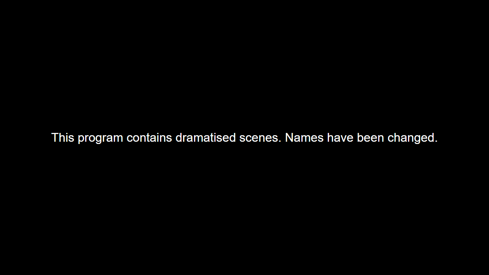
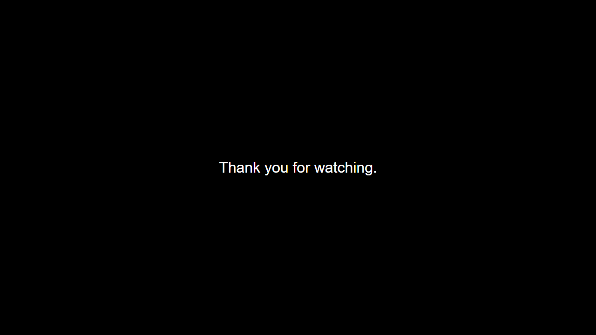

# demo-remotion-card

[](https://github.com/shawnrruss/demo-remotion-card/actions/workflows/ci.yml)

**A 31-second white-on-black disclosure, bullet recap and closing card rendered from one JSON file with React, TypeScript and Remotion.**

<p>
  
  
  
</p>

Original demo, made-up data, not client work. AI-assisted implementation.

## What it shows

- Every word and every frame count comes from `src/data/cards.json`; a test walks
  `src/compositions/` and fails if a sample string is hard-coded in a component.
- `src/timing.ts` derives all durations (`holdSeconds` × fps, recap, closing) instead of
  hand-tuned frame numbers: 8/20/3 seconds at 24 fps is 192/480/72 frames, 744 in total.
- `showRecap: false` removes exactly the 480 recap frames (744 → 264) and the `Sequence`
  itself disappears; both the arithmetic and the rendered tree are tested.
- `src/schema.ts` validates the JSON before a render starts and rejects missing, empty and
  whitespace-only copy.
- Renders offline: no external fonts, assets or runtime network calls, dependencies pinned,
  Arial from the host system.

## Quick start

```sh
npm ci
npm test
npm run typecheck
npm run lint
npm run preview:still   # docs/preview.png: frame 24 at 1280x720
npm run render:preview  # out/preview.mp4: first 48 frames at 1280x720
npm run render          # out/main.mp4: the full 3840x2160 render
```

`Main` is 3840x2160 at the JSON's 24 fps. The disclosure holds for `holdSeconds`
(defaults to 8 seconds when omitted), without text animation. The sample recap
holds for 20 seconds; set `showRecap` to `false` to remove its sequence and shorten
the video by 480 frames. The closing card holds for `endSeconds` (3 in the sample).
The sample totals 744 frames (31 seconds), or 264 frames (11 seconds) without recap.

The preview renders the first 48 frames (2 seconds) at 1280x720 to
`out/preview.mp4`; the full render writes `out/main.mp4`. The first render may
download Remotion's browser; rendering uses local data and system Arial afterward.
Dependencies are pinned. `node_modules/`, `out/` and the local npm cache are ignored.

The three pictures above are real renders of the `Main` composition at 1280x720
(frames 24, 400 and 720). `npm run preview:still` re-renders the first one into
`docs/preview.png`.

## Tests

`npm test` runs 9 tests in `tests/timing.test.ts` and `tests/cards.test.tsx`:

- hold frames equal `holdSeconds` x fps (8 seconds at 24 fps is 192 frames, and an omitted
  `holdSeconds` falls back to 8 seconds)
- every duration is derived from the JSON and the fps (2/4/1 seconds at 30 fps is 60/120/30/210)
- the recap toggle removes exactly its 480 frames (the sample goes from 744 to 264 frames)
- `Main` drops the recap sequence when `showRecap` is `false`
- the rendered disclosure text equals the JSON text, whitespace and punctuation included
- validation rejects missing, empty and whitespace-only text
- no sample text is hard-coded in the composition sources

`npm run lint` is a strict TypeScript pass (`noUnusedLocals`, `noUnusedParameters`,
`noImplicitReturns`, `noFallthroughCasesInSwitch`) over `src` and `tests`;
`npm run typecheck` is the plain `tsc --noEmit`. ESLint is deliberately not a dependency:
adding it would change `package-lock.json`, which CI installs from.

## Project layout

```text
.github/workflows/ci.yml   push + pull_request: npm ci, lint, typecheck, test on Node 22
src/index.ts               Remotion entry point
src/Root.tsx               the Main composition: size, fps, duration from the JSON
src/schema.ts              Cards type and validate()
src/timing.ts              frame arithmetic
src/compositions/Main.tsx  the three Sequences
src/compositions/Cards.tsx the three card components
src/data/cards.json        all wording and timing
tests/                     Vitest: 9 tests
docs/preview*.png          rendered stills used by this README
```
